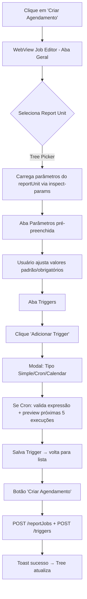

# Etapa 15: JasperServer Scheduler (Agendamento de Execuções no Servidor)

---

## 1. Objetivo
Permitir gerenciar agendamentos (jobs/triggers) de relatórios diretamente no JasperServer a partir do VS Code: criar, listar, editar, deletar, pausar/retomar, visualizar histórico de execuções e configurar parâmetros de recorrência.

---

## 2. Requisitos Funcionais

### 2.1 Entidades JasperServer (REST API v2)
| Entidade | Endpoint | Descrição |
|----------|----------|-----------|
| **Report Job** | `/rest/v2/reportJobs` | Job de execução de relatório (referencia reportUnit + outputFormat + parâmetros) |
| **Trigger** | `/rest/v2/scheduler/triggers` | Gatilho de agendamento (SimpleTrigger, CronTrigger, CalendarTrigger) |
| **Job Execution** | `/rest/v2/reportExecutions` | Histórico de execuções (status, tempo, output, erro) |
| **Report Unit** | `/rest/v2/resources` | O relatório (.jrxml/.jasper) no repositório |

### 2.2 Operações CRUD

#### Report Jobs
| Operação | Endpoint | Descrição |
|----------|----------|-----------|
| **Listar** | `GET /rest/v2/reportJobs` | Lista todos os jobs (paginado, filtro por nome/reportUnit) |
| **Criar** | `POST /rest/v2/reportJobs` | Cria job vinculando reportUnit + outputFormat + parâmetros padrão |
| **Obter** | `GET /rest/v2/reportJobs/{id}` | Detalhes do job |
| **Atualizar** | `PUT /rest/v2/reportJobs/{id}` | Atualiza parâmetros, outputFormat, descrição |
| **Deletar** | `DELETE /rest/v2/reportJobs/{id}` | Remove job (cascata remove triggers associados) |
| **Executar Agora** | `PUT /rest/v2/reportJobs/{id}/runNow` | Dispara execução imediata (opcional sobrescrever parâmetros) |

#### Triggers (Agendamento)
| Operação | Endpoint | Descrição |
|----------|----------|-----------|
| **Listar por Job** | `GET /rest/v2/reportJobs/{jobId}/triggers` | Triggers vinculados ao job |
| **Criar** | `POST /rest/v2/reportJobs/{jobId}/triggers` | Cria SimpleTrigger, CronTrigger ou CalendarTrigger |
| **Obter** | `GET /rest/v2/scheduler/triggers/{triggerId}` | Detalhes do trigger |
| **Atualizar** | `PUT /rest/v2/scheduler/triggers/{triggerId}` | Modifica expressão cron, recorrência, timezone |
| **Deletar** | `DELETE /rest/v2/scheduler/triggers/{triggerId}` | Remove trigger |
| **Pausar** | `PUT /rest/v2/scheduler/triggers/{triggerId}/pause` | Pausa trigger |
| **Retomar** | `PUT /rest/v2/scheduler/triggers/{triggerId}/resume` | Retoma trigger pausado |

#### Histórico de Execuções
| Operação | Endpoint | Descrição |
|----------|----------|-----------|
| **Listar Execuções** | `GET /rest/v2/reportJobs/{jobId}/executions` | Histórico paginado (status, startTime, endTime, output, erro) |
| **Obter Execução** | `GET /rest/v2/reportExecutions/{executionId}` | Detalhes + download output (PDF, XLS, etc.) |
| **Cancelar Execução** | `PUT /rest/v2/reportExecutions/{executionId}/cancel` | Cancela execução em andamento |

---

## 2.3 Tipos de Trigger Suportados

| Tipo | Configuração | Caso de Uso |
|------|--------------|-------------|
| **SimpleTrigger** | `repeatInterval` (ms), `repeatCount`, `startTime`, `endTime` | Execução a cada X minutos/horas |
| **CronTrigger** | `cronExpression` (Quartz), `timezone`, `startTime`, `endTime` | Agendamento complexo (ex: "todo dia útil às 06:00") |
| **CalendarTrigger** | `calendarName`, `cronExpression` | Agendamento com calendário de feriados (avançado) |

---

## 2.4 UI no VS Code

### 2.4.1 TreeView no JasperServer Explorer (Novo Nó)
```
📁 JasperServer (conexão ativa)
  ├── 📂 Reports (pastas/relatórios existentes)
  ├── 📂 Schedules (NOVO)
  │    ├── 📋 Job: "Ficha Atendimento Diária"
  │    │    ├── ⏰ Trigger: "Cron 0 0 6 ? * MON-FRI *" (Ativo)
  │    │    └── 📜 Última execução: 2026-01-15 06:00:12 ✓
  │    ├── 📋 Job: "Relatório Mensal Financeiro"
  │    │    ├── ⏰ Trigger: "Simple 1h x 24" (Pausado)
  │    │    └── 📜 Última execução: 2026-01-14 14:00:05 ✗
  │    └── ➕ [Criar Novo Agendamento...]
```

### 2.4.2 Ações no TreeView (Context Menu)
| Item | Ações |
|------|-------|
| **Pasta "Schedules"** | "Criar Agendamento", "Atualizar (F5)", "Buscar (Ctrl+F)" |
| **Job** | "Editar Job", "Executar Agora", "Ver Execuções", "Pausar Todos Triggers", "Deletar Job" |
| **Trigger** | "Editar Trigger", "Pausar/Retomar", "Deletar Trigger" |
| **Execução** | "Ver Detalhes", "Baixar Output", "Cancelar (se running)" |

### 2.4.3 WebView de Criação/Edição de Job
| Aba | Campos |
|-----|--------|
| **Geral** | Nome*, Descrição, Report Unit* (tree picker), Output Format* (PDF, XLS, CSV, RTF, HTML, JRP) |
| **Parâmetros** | Grid editável (nome, tipo, valor padrão, obrigatório) - pré-preenchido do reportUnit |
| **Triggers** | Lista de triggers + botão "Adicionar Trigger" (modal com tipo Simple/Cron/Calendar) |

### 2.4.4 WebView de Histórico de Execuções
| Coluna | Detalhe |
|--------|---------|
| **Status** | ✓ Sucesso / ✗ Erro / ⏳ Running / ⏸ Cancelado |
| **Início** | Timestamp |
| **Fim** | Timestamp (duração) |
| **Output** | Link para download (se sucesso) |
| **Erro** | Tooltip com stack trace (se erro) |
| **Parâmetros** | Ícone para ver parâmetros usados |

---

## 2.5 Keybindings

| Atalho | Comando | Contexto |
|--------|---------|----------|
| `Ctrl+Shift+Alt+S` | `jasper.openScheduler` | Abre painel Schedules |
| `F5` | `jasper.refreshSchedules` | Atualiza tree (quando foco em Schedules) |
| `Ctrl+N` | `jasper.createScheduleJob` | Novo Job (quando foco em Schedules) |
| `Enter` | `jasper.runJobNow` | Executar Agora (em Job selecionado) |
| `Delete` | `jasper.deleteScheduleJob` | Deletar Job/Trigger |

---

## 3. Requisitos Não-Funcionais

| Requisito | Especificação |
|-----------|---------------|
| **Autenticação** | Reutiliza `JasperServerClient` (session cookie + CSRF token) |
| **Paginação** | `limit=50`, `offset` para listas grandes |
| **Cache** | Cache local de 30s para listagem de jobs (invalidação em mutações) |
| **Error Handling** | Toast notifications + log no Output Channel "JasperServer" |
| **Timezone** | Exibição no timezone local do usuário (IANA tz database) |
| **Validação Cron** | Validação client-side de expressões Quartz Cron antes de enviar |

---

## 4. Arquitetura Técnica

### 4.1 Novo Serviço: `JasperServerSchedulerService` (`src/services/jasperServerScheduler.ts`)
```typescript
interface ReportJob {
  id: string;
  name: string;
  description?: string;
  reportUnitUri: string;        // /public/reports/FichaAtendimento
  outputFormat: 'PDF' | 'XLS' | 'CSV' | 'RTF' | 'HTML' | 'JRP';
  parameters: JobParameter[];
  triggers: Trigger[];
  createdAt: string;
  updatedAt: string;
}

interface JobParameter {
  name: string;
  type: string;                 // java.lang.String, java.lang.Integer, etc.
  defaultValue?: string;
  isRequired: boolean;
  isForPrompting: boolean;
}

interface Trigger {
  id: string;
  jobId: string;
  type: 'SIMPLE' | 'CRON' | 'CALENDAR';
  cronExpression?: string;      // Para CRON
  repeatInterval?: number;      // ms para SIMPLE
  repeatCount?: number;         // -1 = infinito
  startTime: string;            // ISO 8601
  endTime?: string;
  timezone: string;             // America/Sao_Paulo
  state: 'NORMAL' | 'PAUSED' | 'COMPLETE' | 'ERROR' | 'BLOCKED';
  nextFireTime?: string;
  previousFireTime?: string;
}

interface JobExecution {
  id: string;
  jobId: string;
  status: 'SUCCESS' | 'FAILED' | 'RUNNING' | 'CANCELLED';
  startTime: string;
  endTime?: string;
  outputResource?: { uri: string; mimeType: string };
  errorMessage?: string;
  parameters: Record<string, string>;
}

export class JasperServerSchedulerService {
  // Jobs
  listJobs(filter?: { name?: string; reportUnitUri?: string }): Promise<ReportJob[]>;
  getJob(jobId: string): Promise<ReportJob>;
  createJob(job: Omit<ReportJob, 'id' | 'createdAt' | 'updatedAt' | 'triggers'>): Promise<ReportJob>;
  updateJob(jobId: string, patch: Partial<ReportJob>): Promise<ReportJob>;
  deleteJob(jobId: string): Promise<void>;
  runJobNow(jobId: string, overrideParams?: Record<string, string>): Promise<JobExecution>;

  // Triggers
  listTriggers(jobId: string): Promise<Trigger[]>;
  createTrigger(jobId: string, trigger: Omit<Trigger, 'id' | 'jobId' | 'state' | 'nextFireTime' | 'previousFireTime'>): Promise<Trigger>;
  getTrigger(triggerId: string): Promise<Trigger>;
  updateTrigger(triggerId: string, patch: Partial<Trigger>): Promise<Trigger>;
  deleteTrigger(triggerId: string): Promise<void>;
  pauseTrigger(triggerId: string): Promise<void>;
  resumeTrigger(triggerId: string): Promise<void>;

  // Executions
  listExecutions(jobId: string, limit?: number, offset?: number): Promise<JobExecution[]>;
  getExecution(executionId: string): Promise<JobExecution>;
  downloadExecutionOutput(executionId: string): Promise<Uint8Array>;
  cancelExecution(executionId: string): Promise<void>;

  // Utilitários
  validateCronExpression(expr: string): { valid: boolean; error?: string; nextRuns?: string[] };
  getReportUnitParameters(reportUnitUri: string): Promise<JobParameter[]>; // Inspeciona reportUnit para sugerir parâmetros
}
```

### 4.2 TreeProvider: `SchedulerTreeProvider` (`src/providers/schedulerTreeProvider.ts`)
- Estende `vscode.TreeDataProvider<SchedulerTreeItem>`
- Lazy loading: carrega jobs apenas ao expandir pasta "Schedules"
- Integração com `ServerSearchController` (Ctrl+F client-side)
- Integração com `ServerClipboardController` (Ctrl+C/V para duplicar jobs)

### 4.3 WebViews
| WebView | Arquivo |
|---------|---------|
| **Job Editor** | `webviews/scheduler-job-editor/` (criar/editar job + triggers) |
| **Execution History** | `webviews/scheduler-history/` (lista paginada, download, cancel) |
| **Trigger Editor** | `webviews/scheduler-trigger-editor/` (modal dentro do Job Editor) |

---

## 5. Integração VS Code

### 5.1 Package.json (Contributions)
```json
{
  "views": {
    "jasper-servers": [
      { "id": "jasper-schedules", "name": "Agendamentos", "when": "jasperServerConnected" }
    ]
  },
  "commands": [
    { "command": "jasper.openScheduler", "title": "Abrir Agendamentos", "category": "Jasper", "icon": "$(clock)", "keybindings": [{ "command": "jasper.openScheduler", "key": "ctrl+shift+alt+s" }] },
    { "command": "jasper.refreshSchedules", "title": "Atualizar Agendamentos", "category": "Jasper", "keybindings": [{ "command": "jasper.refreshSchedules", "key": "f5", "when": "view == jasper-schedules" }] },
    { "command": "jasper.createScheduleJob", "title": "Criar Agendamento", "category": "Jasper", "keybindings": [{ "command": "jasper.createScheduleJob", "key": "ctrl+n", "when": "view == jasper-schedules" }] },
    { "command": "jasper.editScheduleJob", "title": "Editar Agendamento", "category": "Jasper" },
    { "command": "jasper.runJobNow", "title": "Executar Agora", "category": "Jasper", "keybindings": [{ "command": "jasper.runJobNow", "key": "enter", "when": "view == jasper-schedules && viewItem =~ /^scheduleJob/" }] },
    { "command": "jasper.deleteScheduleJob", "title": "Deletar Agendamento", "category": "Jasper", "keybindings": [{ "command": "jasper.deleteScheduleJob", "key": "delete", "when": "view == jasper-schedules && viewItem =~ /^scheduleJob/" }] },
    { "command": "jasper.pauseTrigger", "title": "Pausar Trigger", "category": "Jasper" },
    { "command": "jasper.resumeTrigger", "title": "Retomar Trigger", "category": "Jasper" },
    { "command": "jasper.deleteTrigger", "title": "Deletar Trigger", "category": "Jasper" },
    { "command": "jasper.viewJobExecutions", "title": "Ver Execuções", "category": "Jasper" },
    { "command": "jasper.downloadExecutionOutput", "title": "Baixar Output", "category": "Jasper" },
    { "command": "jasper.cancelExecution", "title": "Cancelar Execução", "category": "Jasper" }
  ],
  "menus": {
    "view/item/context": [
      { "command": "jasper.createScheduleJob", "when": "view == jasper-schedules && viewItem == schedulesRoot", "group": "1_jasper@1" },
      { "command": "jasper.refreshSchedules", "when": "view == jasper-schedules", "group": "1_jasper@2" },
      { "command": "jasper.editScheduleJob", "when": "view == jasper-schedules && viewItem =~ /^scheduleJob/", "group": "1_jasper@3" },
      { "command": "jasper.runJobNow", "when": "view == jasper-schedules && viewItem =~ /^scheduleJob/", "group": "1_jasper@4" },
      { "command": "jasper.viewJobExecutions", "when": "view == jasper-schedules && viewItem =~ /^scheduleJob/", "group": "1_jasper@5" },
      { "command": "jasper.deleteScheduleJob", "when": "view == jasper-schedules && viewItem =~ /^scheduleJob/", "group": "1_jasper@6" },
      { "command": "jasper.pauseTrigger", "when": "view == jasper-schedules && viewItem =~ /^scheduleTrigger/ && viewItem =~ /state=NORMAL/", "group": "1_jasper@3" },
      { "command": "jasper.resumeTrigger", "when": "view == jasper-schedules && viewItem =~ /^scheduleTrigger/ && viewItem =~ /state=PAUSED/", "group": "1_jasper@3" },
      { "command": "jasper.deleteTrigger", "when": "view == jasper-schedules && viewItem =~ /^scheduleTrigger/", "group": "1_jasper@6" }
    ]
  }
}
```

---

## 6. Arquivos a Criar/Modificar

| Arquivo | Tipo |
|---------|------|
| `src/services/jasperServerScheduler.ts` | **Novo** (serviço completo REST v2) |
| `src/providers/schedulerTreeProvider.ts` | **Novo** (TreeView Schedules) |
| `src/webviewPanels/schedulerJobEditorPanel.ts` | **Novo** (WebView criar/editar job) |
| `src/webviewPanels/schedulerHistoryPanel.ts` | **Novo** (WebView histórico execuções) |
| `webviews/scheduler-job-editor/` | **Novo** (index.html, main.js, styles.css) |
| `webviews/scheduler-history/` | **Novo** (index.html, main.js, styles.css) |
| `webviews/scheduler-trigger-editor/` | **Novo** (modal trigger) |
| `src/commands/serverCommands.ts` | **Modificado** (comandos scheduler) |
| `src/extension.ts` | **Modificado** (registro providers/webviews) |
| `package.json` | **Modificado** (views, commands, menus, keybindings) |
| `docs/ETAPA_15_JASPERSERVER_SCHEDULER.md` | **Novo** (esta spec) |

---

## 7. Critérios de Aceite

| Critério | Validação |
|----------|-----------|
| **Listar Jobs** | Expande "Agendamentos" → carrega jobs do servidor |
| **Criar Job** | "Criar Agendamento" → WebView → seleciona Report Unit → define parâmetros → adiciona Trigger Cron → salva → job aparece no tree |
| **Editar Job** | Clique direito no Job → "Editar" → WebView pré-preenchida → salva → atualiza |
| **Executar Agora** | Enter no Job → dispara execução → toast "Execução iniciada" → aparece no histórico |
| **Criar Trigger Cron** | No Job Editor → "Adicionar Trigger" → tipo Cron → valida expressão Quartz → preview próximas 5 execuções |
| **Pausar/Retomar Trigger** | Clique direito no Trigger → Pausar/Retomar → ícone muda → estado persiste no servidor |
| **Histórico Execuções** | "Ver Execuções" → WebView paginada → status coloridos → download output funciona |
| **Deletar Job** | Delete no Job → confirmação → remove do servidor e tree |
| **Validação Cron** | Expressão inválida → erro inline com sugestão |
| **Timezone** | Horários exibidos em America/Sao_Paulo (local) |
| **Performance** | Listagem 50 jobs < 1s |
| **npm run compile** | Exit code 0 |

---

## 8. Dependências Externas (package.json)

| Pacote | Uso |
|--------|-----|
| `cron-parser` | Parse/validação de expressões Quartz Cron + preview próximas execuções |
| `date-fns-tz` | Conversão/exibição de timestamps no timezone do usuário |

---

## 9. Fluxo de Criação de Agendamento (UX)



---

## 10. Validação Técnica

| Teste | Comando | Esperado |
|-------|---------|----------|
| Compilação TS | `npm run compile` | Exit code 0 |
| Listar Jobs | Expande "Agendamentos" | Jobs carregados do servidor |
| Criar Job | Ctrl+N → preenche → salva | Job criado no servidor + tree |
| Trigger Cron | Adiciona Cron `0 0 6 ? * MON-FRI *` | Valida + preview 5 próximas execuções |
| Executar Agora | Enter no Job | Execution iniciada + aparece no histórico |
| Histórico | Ver Execuções | Lista paginada + download output |
| Pausar Trigger | Clique direito → Pausar | Estado PAUSED no servidor + ícone |
| Timezone | Horários exibidos | America/Sao_Paulo |
| Search | Ctrl+F no Schedules | Filtro client-side funciona |